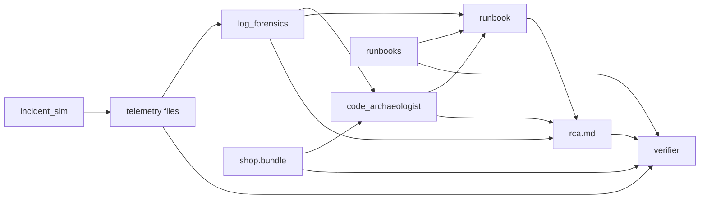
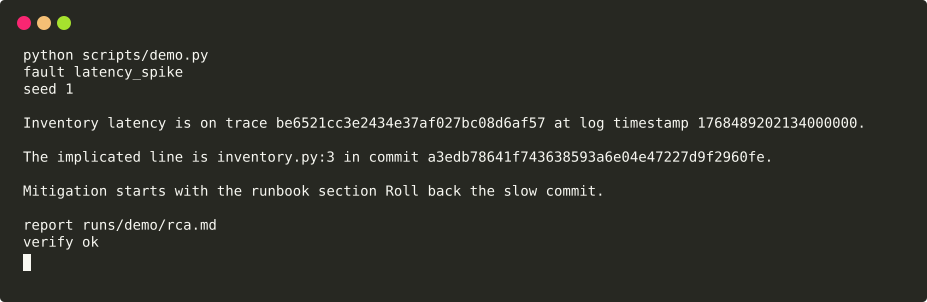

# Multi-Agent Incident Responder

This repository simulates a checkout outage and writes a root-cause report where each factual sentence cites a log timestamp, a trace or span id, a commit and source line, or a runbook section. An orchestrator runs four stages in order: a simulator that writes OpenTelemetry traces, logs, and metrics; log forensics, which names the service and the onset; a code archaeologist, which ranks commits in a small git history; and a runbook stage, which selects mitigation steps from a catalog. A verifier rejects the report when a cited id does not match the underlying file. The default path is deterministic. It records zero tokens and does not call a model.

## Architecture

The checkout path is four modules, `gateway`, `orders`, `inventory`, and `payments`. The orchestrator calls the stages below in that order and writes `rca.json` and `rca.md`. The simulator also writes `ground_truth.json`. The later stages do not open it.



## Quickstart

Python 3.11 or newer, and `git` on `PATH`. The scenario is loaded from `sample_history/shop.bundle`. Docker is not used.

```bash
python3 -m venv .venv
source .venv/bin/activate
pip install -e '.[dev]'
make demo
```

`make demo` runs `latency_spike` with seed 1, 24 requests, and 8 warmup requests. It writes `runs/demo/rca.md` and prints that path plus the verifier result. `runs/` is gitignored.

These commands were run from a clean clone on Python 3.12.3.



`docs/demo.cast` is an asciinema recording of the same command. The image is the last frame.

## Example

`examples/latency_spike/rca.md` is that same case, committed so the report can be read without running anything. `make demo` reproduces it. The summary is:

> Inventory latency is on trace be6521cc3e2434e37af027bc08d6af57 at log timestamp 1768489202134000000.
>
> The implicated line is inventory.py:3 in commit a3edb78641f743638593a6e04e47227d9f2960fe.
>
> Mitigation starts with the runbook section Roll back the slow commit.

The root-cause section names the assignment:

> Commit a3edb78641f743638593a6e04e47227d9f2960fe sets `WORK_MS = 750` at inventory.py:3.

## Faults

| Fault | Service | What the commit changes |
| --- | --- | --- |
| `latency_spike` | inventory | `reserve` rebuilds a catalog index and `WORK_MS` goes from 12 to 750. |
| `error_rate_spike` | payments | The processor check is inverted, so approval code `00` fails. |
| `dependency_timeout` | payments | Charge waits 2000ms. Orders stops at its 800ms deadline. |
| `bad_deploy` | payments | `CURRENCY_SCALE` becomes 100, so an 8000 cent charge is rejected as 800000. |

Healthy payments still declines processor codes `05` and `91`. That baseline is not treated as an incident. The error-rate fault is the later jump, when code `00` starts failing.

## Results

`python -m orchestrator.eval` runs the four faults with seeds 1 through 5, 24 requests, and 8 warmup requests. Ground truth is deleted before the stages run. A case scores 1 when the cited commit is the deployed commit, the service matches, replaying the mitigation leaves no incident, and the citations resolve. Any miss scores 0.

| Fault | Runbook | Root cause | Cleared | Citations | Mean score |
| --- | --- | --- | ---: | ---: | ---: |
| `bad_deploy` | `revert-config` | 5/5 | 5/5 | 5/5 | 1.000 |
| `dependency_timeout` | `rollback-timeout` | 5/5 | 5/5 | 5/5 | 1.000 |
| `error_rate_spike` | `rollback-check` | 5/5 | 5/5 | 5/5 | 1.000 |
| `latency_spike` | `rollback-latency` | 5/5 | 5/5 | 5/5 | 1.000 |

On the clean clone above, 20 of 20 cases passed. Wall clock was 1.985 seconds. The run recorded 0 input tokens and 0 output tokens, including 0/0 on forensics, the archaeologist, the runbook stage, and the orchestrator.

## Tokens and cost

Deterministic mode is the default. Leave `LOG_FORENSICS_LLM`, `CODE_ARCHAEOLOGIST_LLM`, `RUNBOOK_LLM`, and `ORCHESTRATOR_LLM` unset, or set them to `off`. Each stage then writes `tokens.input` and `tokens.output` as 0. The orchestrator adds those fields up. It does not estimate tokens from the length of a prompt. The eval above is that mode: 0 input tokens and 0 output tokens, so the model cost of the reported run is zero.

Setting any of those variables to `openai` sends a short digest to an OpenAI-compatible chat endpoint. The default model is `gpt-4o-mini`, and `OPENAI_MODEL` overrides it. `OPENAI_API_KEY` is required. Usage is copied from the response. That path was not run here, and this page does not state a price for it.

## Design decisions

- The stages are functions called in a fixed order. Each one returns JSON, and the next stage reads that JSON. The orchestrator is the caller.
- The simulator writes `ground_truth.json` next to the telemetry. The stages never open it. The eval deletes the file before they run and uses a saved copy only when scoring.
- Onset comes from one span and one log per request. Latency is the service's own span time with child spans removed, so a slow `reserve` stays on inventory. Metrics are scraped twice per run, once after warmup and once at the end. That window is too wide for an onset.
- The archaeologist ranks the diff, and `git blame` has to attribute the cited line to that commit. Commit subjects are not loaded. The sample history has later commits on the same file that leave the fault line alone, and the fault subjects describe the edit without naming the fault.
- Runbook selection compares the forensics kind with the shape of the cited line. The fault name is not an input. The inverted processor check and the bad `CURRENCY_SCALE` are both payments error-rate incidents, and they select `rollback-check` and `revert-config`.
- Time starts at 2026-01-15 15:00:00 UTC. Each checkout is served, the clock advances by the span durations plus a 100ms gap, and the next checkout starts. The service functions return a duration from `WORK_MS`. They do not sleep.

## Limitations

- The faults are four synthetic commits in a four-file checkout service. They are not incidents from a production system.
- The clock is simulated, and the checkouts run one after another. There is no overlap and no clock skew. A slow fault does not take wall-clock time.
- The archaeologist explains three diff shapes: a changed `*_MS` constant scored against the before and after durations, an inverted `if` that guards a new error log, and a changed multiplier that makes a reported amount fail a range check it used to pass. Other edits on the file stay in the ranking at a lower score.
- The verifier checks that a trace id, span id, timestamp, commit, `file:line`, or runbook heading in a sentence appears in a citation, and that the citation matches the file. A number written next to those ids is not part of the check. The impact section states a millisecond duration beside a span id, and a wrong duration on a real span id still passes.
- Forensics looks for one change that continues to the end of the run. A spike that recovers before the run ends can be missed.

## Checks

```bash
pytest
python -m orchestrator.eval
```

GitHub Actions runs both on push and on pull request. The individual stages are `python -m incident_sim`, `python -m log_forensics`, `python -m code_archaeologist`, `python -m runbook`, and `python -m orchestrator.verify`.
